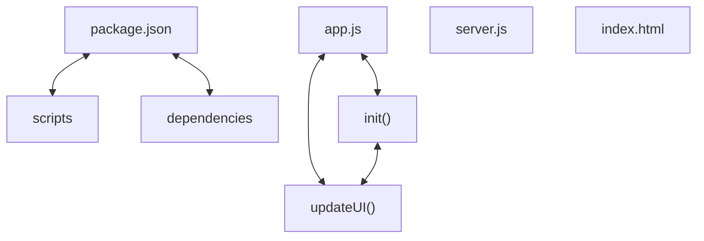

# Codebase Architectural Report

> **Auto-generated** by graphify knowledge graph analysis  
> **Purpose**: Dependency map, connection analysis, subsystem breakdown, and quality hotspots.

---

## 1. Executive Summary

- **Total Components**: `32`
- **Total Connections**: `34`
- **Subsystem Modules**: `6`
- **Dependency Types**: `3`

**Key Architectural Hubs:**

| # | Component | File | Type | Connections |
|---|-----------|------|------|-------------|
| 1 | `app.js` | `public/app.js` | file | 8 |
| 2 | `package.json` | `package.json` | function | 6 |
| 3 | `server.js` | `server.js` | file | 5 |
| 4 | `index.html` | `public/index.html` | function | 5 |
| 5 | `updateUI()` | `public/app.js` | method | 4 |
| 6 | `scripts` | `package.json` | function | 3 |
| 7 | `dependencies` | `package.json` | function | 3 |
| 8 | `init()` | `public/app.js` | method | 3 |

---

## 2. Dependency & Connection Analysis

### Relationship Types

| Relationship | Count | Share |
|-------------|-------|-------|
| `contains` | 23 | 68% |
| `calls` | 9 | 26% |
| `references` | 2 | 6% |

### Hub Dependency Diagram

### Most Connected Pairs

| Component A | Component B | Shared Connections |
|-------------|-------------|-------------------|
| `dependencies` | `package.json` | 1 |
| `description` | `package.json` | 1 |
| `main` | `package.json` | 1 |
| `name` | `package.json` | 1 |
| `package.json` | `scripts` | 1 |
| `package.json` | `version` | 1 |
| `dev` | `scripts` | 1 |
| `scripts` | `start` | 1 |
| `cors` | `dependencies` | 1 |
| `dependencies` | `express` | 1 |

---

## 3. Subsystem & Module Breakdown

### 3.1 public/index.html
**Nodes**: `6`  
**Files**: `public/index.html`

| Component | Type | File | Connections |
|-----------|------|------|-------------|
| `index.html` | function | `public/index.html` | 5 |
| `style.css` | function | `public/index.html` | 1 |
| `app.js` | file | `public/index.html` | 1 |
| `toggleAuthModal()` | method | `public/index.html` | 1 |
| `handleCreatePost(event)` | method | `public/index.html` | 1 |
| `handleLogin(event)` | method | `public/index.html` | 1 |

### 3.2 public/app.js
**Nodes**: `9`  
**Files**: `public/app.js`

| Component | Type | File | Connections |
|-----------|------|------|-------------|
| `app.js` | file | `public/app.js` | 8 |
| `updateUI()` | method | `public/app.js` | 4 |
| `init()` | method | `public/app.js` | 3 |
| `handleLogin()` | method | `public/app.js` | 3 |
| `renderPosts()` | method | `public/app.js` | 3 |
| `toggleAuthModal()` | method | `public/app.js` | 2 |
| `handleSignOut()` | method | `public/app.js` | 2 |
| `handleCreatePost()` | method | `public/app.js` | 2 |
| `posts` | function | `public/app.js` | 1 |

### 3.3 server.js
**Nodes**: `6`  
**Files**: `server.js`

| Component | Type | File | Connections |
|-----------|------|------|-------------|
| `server.js` | file | `server.js` | 5 |
| `express` | function | `server.js` | 1 |
| `cors` | function | `server.js` | 1 |
| `path` | function | `server.js` | 1 |
| `app` | function | `server.js` | 1 |
| `posts` | function | `server.js` | 1 |

### 3.4 package.json
**Nodes**: `5`  
**Files**: `package.json`

| Component | Type | File | Connections |
|-----------|------|------|-------------|
| `package.json` | function | `package.json` | 6 |
| `name` | function | `package.json` | 1 |
| `version` | function | `package.json` | 1 |
| `description` | function | `package.json` | 1 |
| `main` | function | `package.json` | 1 |

**External dependencies:** `dependencies` (1), `scripts` (1)

### 3.5 package.json
**Nodes**: `3`  
**Files**: `package.json`

| Component | Type | File | Connections |
|-----------|------|------|-------------|
| `dependencies` | function | `package.json` | 3 |
| `express` | function | `package.json` | 1 |
| `cors` | function | `package.json` | 1 |

**External dependencies:** `package.json` (1)

### 3.6 package.json
**Nodes**: `3`  
**Files**: `package.json`

| Component | Type | File | Connections |
|-----------|------|------|-------------|
| `scripts` | function | `package.json` | 3 |
| `start` | function | `package.json` | 1 |
| `dev` | function | `package.json` | 1 |

**External dependencies:** `package.json` (1)

---

## 4. API Reference

Public classes and functions by subsystem.

### public/index.html

| Name | Type | File | Connections |
|------|------|------|-------------|
| `index.html` | function | `public/index.html` | 5 |
| `style.css` | function | `public/index.html` | 1 |

### public/app.js

| Name | Type | File | Connections |
|------|------|------|-------------|
| `posts` | function | `public/app.js` | 1 |

### server.js

| Name | Type | File | Connections |
|------|------|------|-------------|
| `express` | function | `server.js` | 1 |
| `cors` | function | `server.js` | 1 |
| `path` | function | `server.js` | 1 |
| `app` | function | `server.js` | 1 |
| `posts` | function | `server.js` | 1 |

### package.json

| Name | Type | File | Connections |
|------|------|------|-------------|
| `package.json` | function | `package.json` | 6 |
| `name` | function | `package.json` | 1 |
| `version` | function | `package.json` | 1 |
| `description` | function | `package.json` | 1 |
| `main` | function | `package.json` | 1 |

### package.json

| Name | Type | File | Connections |
|------|------|------|-------------|
| `dependencies` | function | `package.json` | 3 |
| `express` | function | `package.json` | 1 |
| `cors` | function | `package.json` | 1 |

### package.json

| Name | Type | File | Connections |
|------|------|------|-------------|
| `scripts` | function | `package.json` | 3 |
| `start` | function | `package.json` | 1 |
| `dev` | function | `package.json` | 1 |

---

## 5. Code Quality & Architectural Risk Hotspots

### Component Type Distribution

| Type | Count | Share |
|------|-------|-------|
| function | 19 | 59% |
| method | 10 | 31% |
| file | 3 | 9% |

### Dependency Cycles

**6** circular dependency loop(s) detected:

| # | Cycle Path |
|---|-----------|
| 1 | `public_app → public_app_init → public_app_renderposts` |
| 2 | `public_app → public_app_updateui → public_app_init` |
| 3 | `public_app → public_app_handlesignout → public_app_updateui` |
| 4 | `public_app → public_app_handlelogin → public_app_updateui` |
| 5 | `public_app → public_app_toggleauthmodal → public_app_handlelogin` |
| 6 | `public_app → public_app_handlecreatepost → public_app_renderposts` |

### Orphaned Components

No orphaned components detected.

---

## 6. How to Navigate

1. **Interactive D3 Map** — open `graph.html` to explore node connections visually.
2. **Knowledge Graph Queries** — use MCP tools (`graph_query`, `graph_explain_node`, `graph_impact_radius`).
